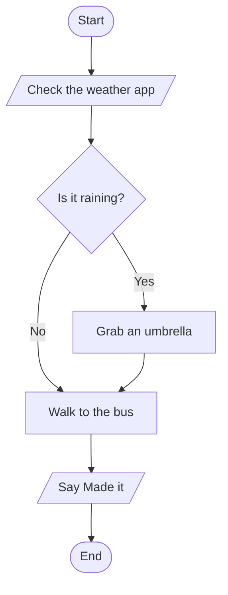

# Flowchart Practice — Pirate Crew Decisions

**Work with a partner.** You'll turn a short pirate story into a flowchart, using the correct shape for every step. Flowcharts are on the WebXam, and the exam questions are mostly about **which shape means what**.

Turn in this document and add your mermaid code at the end part 7.  Both partners push the same file to their own repo, with both names at the top.

Luke and Gavin
---

## Contents

1. [The four shapes](#1-the-four-shapes)
2. [How to draw them in Mermaid](#2-how-to-draw-them-in-mermaid)
3. [A small example](#3-a-small-example)
4. [The story: a new pirate's first week](#4-the-story-a-new-pirates-first-week)
5. [Your job](#5-your-job)
6. [Add your own twist](#6-add-your-own-twist)
7. [Checklist before you push](#7-checklist-before-you-push)

---

## 1. The four shapes

| Shape | Means | Pirate example |
|---|---|---|
| **Oval** | Start or end | "Join the crew" / "End" |
| **Rectangle** | A process: something that gets **done** | "Swab the deck" |
| **Diamond** | A decision: a **yes/no question** | "Is the deck clean?" |
| **Parallelogram** (slanted rectangle) | Input or output: information going **in** or coming **out** | "Count your cannon hits" / Captain shouts "SPLASH!" |
| **Arrow** | Which step comes next | |

**Rules:**

- Every flowchart has **one Start**.
- Every path has to reach an **End**. A path can't just stop.
- Every diamond has **exactly two arrows out**, labeled **Yes** and **No**.
- A diamond's text is always a **question**.
- An arrow can point **back up** to an earlier step. That's a **loop**: it means "do this again."

---

## 2. How to draw them in Mermaid

You used Mermaid for ER diagrams in Unit 3. Flowcharts work the same way: write the code in a `mermaid` code block, and GitHub draws the picture.

| Shape | Mermaid code |
|---|---|
| Oval | `A([Start])` |
| Rectangle | `B[Swab the deck]` |
| Diamond | `C{Is the deck clean?}` |
| Parallelogram | `D[/Count your hits/]` |
| Arrow | `A --> B` |
| Arrow with a label | `C -->|Yes| E` |

- Each shape gets a short ID (`A`, `B`, `C`...). After a shape is made once, you can just use its ID.
- `flowchart TD` at the top means the chart goes **top to bottom**.
- Keep quotation marks and parentheses out of the text inside shapes. They can break the diagram.
- Write the Mermaid code **yourselves**. Don't have AI write it. The point is to choose the shapes.

**To check your diagram:** push your file and open it on GitHub, or use the **Preview** in VS Code.

---

## 3. A small example

Story: *Before school, check the weather. If it's raining, grab an umbrella. Then walk to the bus and say "Made it!"*

Go to mermaid.live and plug this in: 

````

````

Notice:

- Checking the weather is **input** (information coming in), so it's a parallelogram.
- "Is it raining?" is a **question**, so it's a diamond with Yes and No arrows.
- Both the Yes path and the No path end up at the same step ("Walk to the bus").

---

## 4. The story: a new pirate's first week

Read the whole story with your partner before you draw anything.

> You've just joined Captain Redbeard's crew as a brand-new pirate. The first thing the captain does is make you **tell him your pirate name**.  Include your name(s) on the flowchart.
>
> Then you're handed a mop and told to **swab the deck**. When you're done, the captain inspects it. **Is the deck clean?** If it isn't, you have to swab it again, and keep swabbing until it passes.
>
> Once the deck is clean, you **train on the cannon**. Then you fire 10 shots at a floating barrel, and the first mate **counts your hits**.
>
> **Did you hit the barrel 7 or more times?** That's a C or better. If you did, you're **promoted to gunner**, and the captain shouts, **"Welcome, Gunner!"** Your week is over, and you survived.
>
> If you got fewer than 7 hits, things get dangerous. **Does your buddy speak up for you?** If your buddy sticks up for you, the captain makes you the **ship's cook** instead, and grumbles, **"You're safe... for now."** Your week is over.
>
> If nobody speaks up for you, the captain asks one more question: **Did you eat the captain's last biscuit?** If you did, you **walk the plank**, and the whole crew hears **"SPLASH!"** That's the end of your week, and your pirate career.
>
> If you didn't eat the biscuit, you got lucky. You **scrub the galley for a week**, and then you go back to cannon training to try again.

---

## 5. Your job

In `pirateFlowchart_lastname.md`, draw the story as a Mermaid flowchart.

1. Go through the story and decide which shape each **bold** part gets. Fill in the **shape table** in the turn-in file first. It's much easier to draw once you've sorted the shapes.
2. Draw the flowchart. Start at the top with the Start oval.
3. Label every arrow that comes out of a diamond with **Yes** or **No**.
4. Find the two places where the story goes **back** to an earlier step. Those are loops, and they need arrows pointing back up.

**Hints:**

- Telling your name, counting hits, and anything someone **shouts** or **says** are input or output.
- You can use **one End oval** that every ending points to, or a separate End for each ending. Both are correct.

---

## 6. Add your own twist

After the story works, add **one more decision** to the voyage. Make it up yourselves. Some ideas:

- A storm hits. Do you tie down the sails?
- The captain's parrot bites you. Do you bite it back?


Your twist needs:

- **At least one new diamond** (a yes/no question), with **both** a Yes and a No path
- **At least one new rectangle** (something that gets done)
- The new path has to reach an End or connect back into the story

Write one or two sentences in the turn-in file explaining your twist.

---

## 7. Insert your mermaid code here: 
```mermaid
flowchart TD
   flowchart TD
    Start([Start]) --> TellName[/Tell captain your pirate name/]
    TellName --> Swab[Swab the deck]
    Swab --> CleanCheck{Is the deck clean?}
    
    CleanCheck -->|No| Swab
    CleanCheck -->|Yes| TrainCannon[Train on the cannon]
    
    TrainCannon --> CountHits[/First mate counts your hits/]
    CountHits --> HitCheck{Did you hit 7 or more times?}
    
    HitCheck -->|Yes| Gunner[/Promoted to gunner! Welcome, Gunner!/]
    Gunner --> ShipBattle[Ship Battle Begins]
    ShipBattle --> ShipInRange[/Look! A ship is in range/]
    ShipInRange --> GunnerHit{Do you hit them?}
    GunnerHit --> |Yes|ShipDown[Ship Down!]
    GunnerHit --> |No|SinkingEnd[They sunk our ship! We're going down!!]
    SinkingEnd --> End
    ShipDown --> BattleSuccess[We survived another battle!]
    BattleSuccess --> End
    
    HitCheck -->|No| BuddyCheck{Does your buddy speak up?}
    
    BuddyCheck -->|Yes| Cook[/Ship's cook: You're safe... for now/]
    Cook --> End
    
    BuddyCheck -->|No| BiscuitCheck{Did you eat the captain's last biscuit?}
    
    BiscuitCheck -->|Yes| Plank[/Walk the plank! SPLASH!/]
    Plank --> End
    
    BiscuitCheck -->|No| ScrubGalley[Scrub the galley for a week]
    ScrubGalley --> TrainCannon
```


## 8. Checklist before you push

- [ ] Exactly one Start oval
- [ ] Every path reaches an End
- [ ] Every diamond is a question and has exactly two arrows: Yes and No
- [ ] Inputs and outputs are parallelograms
- [ ] Actions are rectangles
- [ ] Both loops from the story point back to the right step
- [ ] Your twist adds a new diamond and a new rectangle
- [ ] The diagram actually draws on GitHub (no red error box)
- [ ] Both partners' names are at the top
